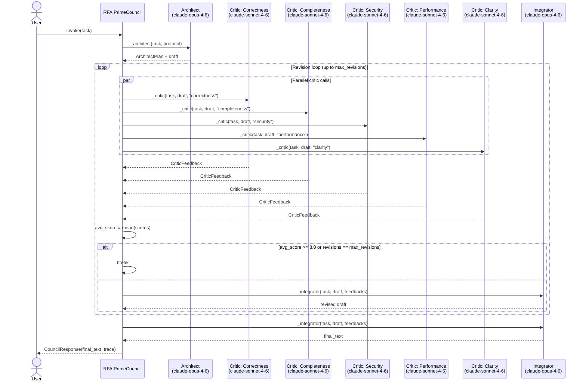

[← Design Doc](rfai_prime_design_doc.md) · [Runtime →](../src/rfai_prime_runtime.py)

---

# RFAI-PRIME v2.0.1 — Sequence Diagram

## `invoke` Path

## Notes

- Critic calls run fully in parallel via `asyncio.gather`.
- The Integrator is called once per revision iteration (to produce a revised draft) and once at the end (final synthesis).
- Early exit fires when the average critic score reaches **8.0** or the revision budget is exhausted — whichever comes first.
- All Anthropic API calls are dispatched with `asyncio.to_thread`; the event loop is never blocked.
